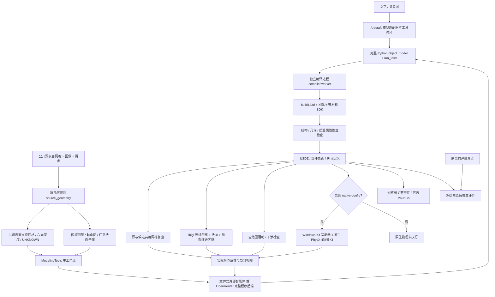

# 架构与代码导航

## 完整数据流

图中图像输入与源网格会话是两条实际入口：当前原始 `articraft generate` 没有自动合并源网格验收；`usdcraft_program` 是文本适配器。不要将图上的模块连线误读成所有后端都已支持图像。

## 模块职责

| 路径（均相对仓库根目录） | 主要对象/入口 | 输入 → 输出 |
| --- | --- | --- |
| `src/articraft/api.py`、`app.py` | `generate` / `generate_async`、CLI | 请求、可选图像 → 生成运行记录 |
| `src/articraft/agent/` | harness、provider、tools、workspace | 模型消息/工具调用 → 工作空间程序与编译反馈 |
| `src/articraft/compiler/worker.py` | `compile_run`、`main` | `workspace/main.py` → 编译与独立验收 payload |
| `src/articraft/sdk/` | `RigidBodyAssembly`、`TestContext`、export | BRep/网格、刚体、关节、材料 → 可检查且可导出的装配 |
| `src/articraft/source_geometry.py` | `analyze_source`、`measure_mesh`、`measure_face`、`measure_plane` | 源三角面 → 观测、网格、区域测量 |
| `src/articraft/geometry_recheck.py` | `recheck_geometry`、`diagnose_geometry`、`compare_part` | 共坐标源/候选 → 全局和局部误差 |
| `src/articraft/usdcraft_workflow.py` | `ModelingTools.submit` / `evaluate` | 完整程序 → 编译/几何/运动/可选原生联合反馈 |
| `src/articraft/usdcraft_session.py` | `prepare`、`host_for_run`、`submit` | 公开输入/候选文件 → 可持续追加的会话与反馈 |
| `src/articraft/usdcraft_program.py` | `ProgramModel`、`audit_program`、`run_program` | SDK 契约/观测/反馈 → 整段程序回复与修订 |
| `src/articraft/usdcraft_io.py` | `read_usd_asset` | USD 资产 → 部件网格、刚体/关节元数据 |
| `src/articraft/usdcraft_motion.py` | `check_motion` | 部件、关节定义 → 运动与干涉扫描 |
| `src/articraft/usdcraft_physx.py` | `validate_native`、`native_identity`、`summarize_native` | 编译资产/固定配置 → 匹配身份的原生验收收据 |
| `scripts/isaac/` | adapter、partition、launcher、runner | 共享盘作业 JSON → 真实 Kit 求解与结构化状态 |
| `src/articraft/usdcraft_evaluation.py` | `evaluate_assembly` | 冻结候选/隔离真值 → 本地评估指标 |
| `src/articraft/usdcraft_benchmark.py` | `build_benchmark`、`render_meshes` | 合成定义/网格 → 本地开发输入/CPU 检视图 |
| `src/articraft/usdcraft_stage.py` | `prepare` / `evaluate` | 诊断探针或冻结资产 → 仪器检查/独立评价 |

## 方法细节与配置

源网格固定共同坐标系，不通过拟合真值对齐候选。表面支持格以源尺寸确定尺度，六向深度表达已观测表面。无表面证据的区域保持 UNKNOWN，不能作为“空”的真值约束。

全局复查使用同一网格的表面覆盖和深度差；局部诊断对源表面采样，使用 libigl 点到三角形的连续距离、无向法向夹角，并将空间相邻失败点聚成区域，返回裁图/边界。`configs/usdcraft_geometry_local.json` 固定采样数、以网格 pitch 表示的距离容差、法向容差和关键区域比例。它们是工程阈值，不是模型训练超参数。

关节几何由 SDK 明确声明局部参考系、轴、范围和父子刚体。运动检查对定义的行程进行离散扫描；离散扫描不等价于连续碰撞证明。原生物理另检查真实求解状态，见 [native-physx.md](native-physx.md)。

目前没有额外训练网络、端到端损失函数或新模型权重。智能体把几何测量/编译/局部诊断/物理验收当成工具反馈来修订程序。`audit_program` 报告程序契约和静态问题，不偷偷补全模型代码。

## 底座与新增部分

Articraft 提供多服务模型适配、建模工具、build123d SDK、编译验收、USD 导出和查看器。USDCraft 复现增加源表面观测、共表示几何复查、局部误差定位、完整程序文件会话、运动检查、原生 PhysX 桥和本地独立评价。

早期 `box_workflow.py`、`box_validation.py` 和 `scripts/box_*.py` 是参数盒基线，保留用于兼容和回归。它们不能替代完整自由程序重建；`box_repair_probe.py` 是明确的人为故障探针，不能计作自然错误修复。

## 尚未完成的技术范围

自动网络搜索/抓取、统一的图像+网格自动多模态后端、论文官方数据和评估协议、复杂曲面碰撞的可靠适配、从实拍恢复真实尺度和质量/摩擦/运动真值均不在当前已完成范围。数据集与论文结果不随源码发布。
